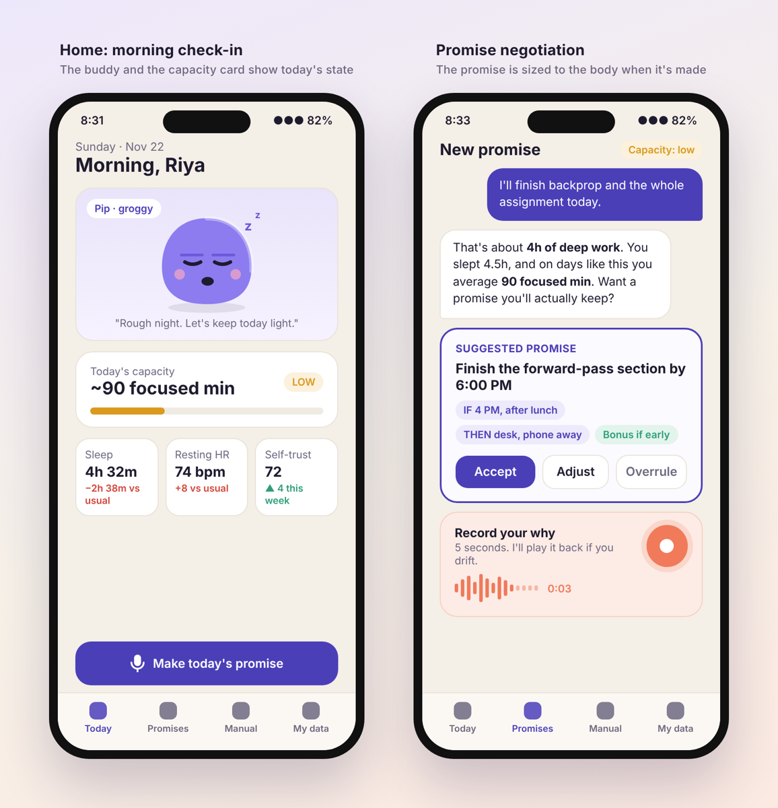
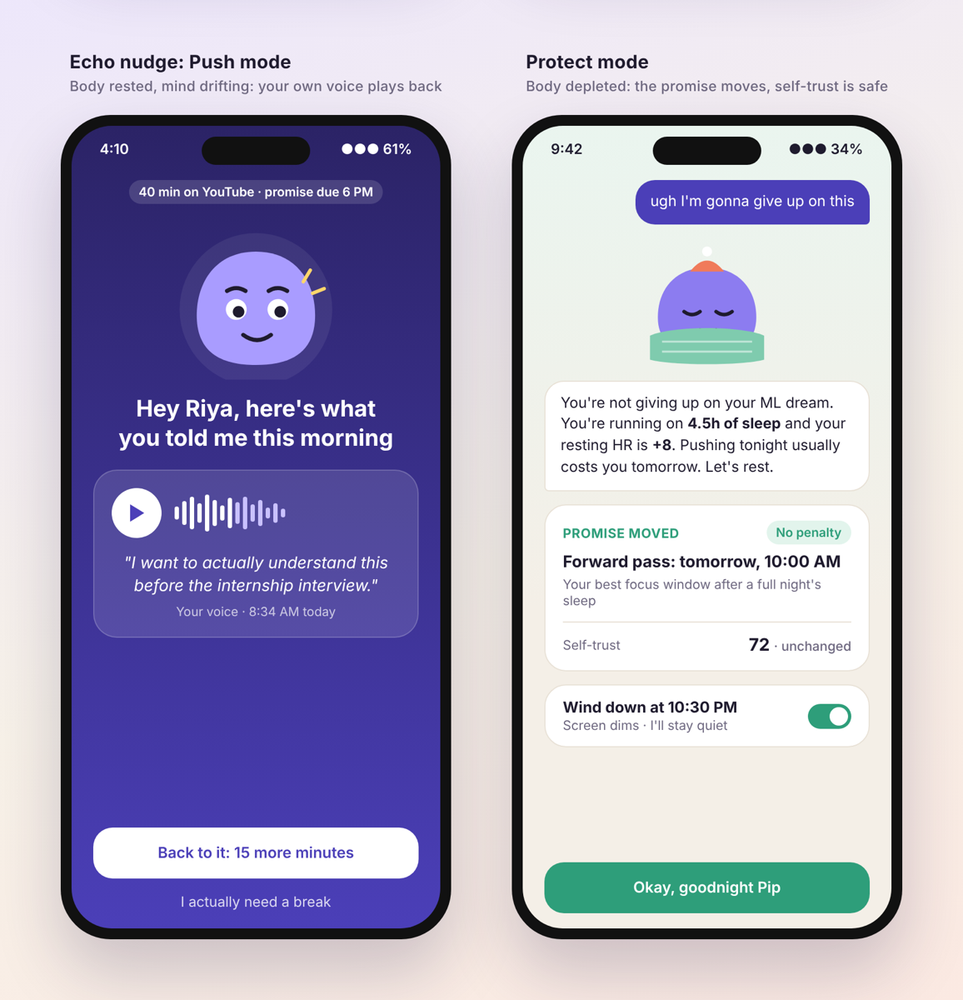
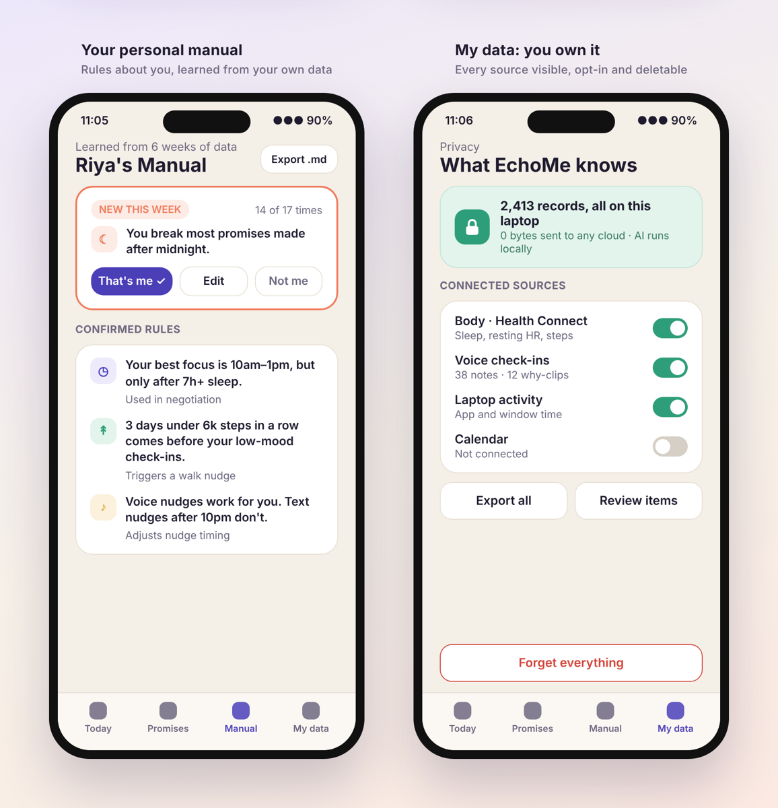
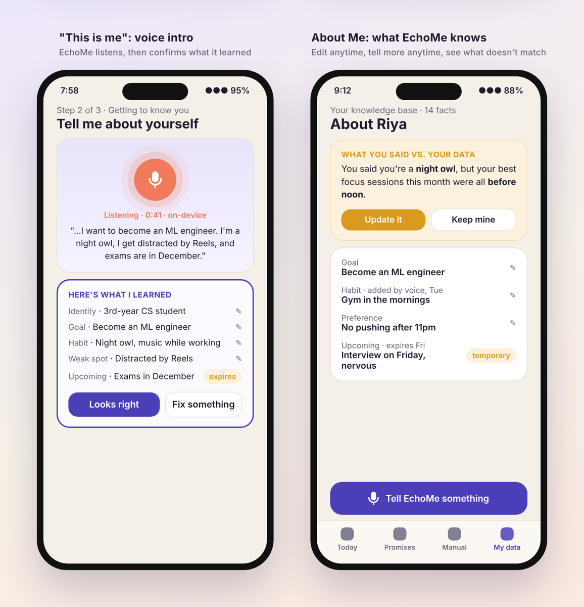
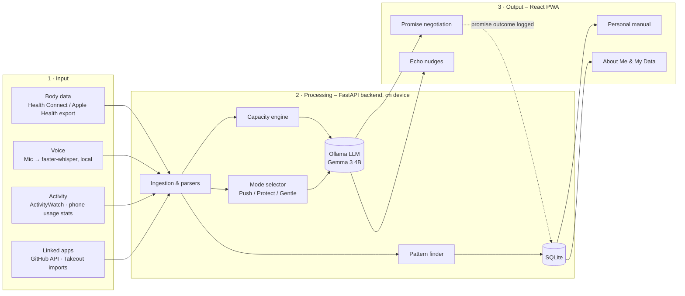

# EchoMe

**Know yourself. Hear yourself.**

EchoMe is an on-device AI buddy that sizes your daily promises to what your body can handle, and nudges you in your own recorded voice when you drift.

> Idea submission for **wHACKiest 2026** (Online Ideathon, Ramaiah Institute of Technology)
> **Track 3: Know Thyself – Your Data. Your Intelligence.**
> Team **Alt F4** · Cambridge Institute of Technology · Team ID `0acceace`

🎥 **Pitch video:** https://youtu.be/q85onK3FPhc
📊 **Pitch deck:** [`pitch/EchoMe_wHACKiest26.pdf`](pitch/EchoMe_wHACKiest26.pdf) ([.pptx](pitch/EchoMe_wHACKiest26.pptx))

> **Status:** This repository holds the concept, product design and proposed architecture. It is an idea-stage submission; no working app is included yet.

---

## The problem

- We make daily promises our body can't keep that day: a full study plan after a sleepless night or an exhausting day.
- We break them, and every broken promise erodes self-trust.
- Our phones and wearables record sleep, heart rate and screen time, but they only show charts. They never help at the moment we decide.

**Why it matters (India):**

| Fact | Source |
|---|---|
| 59% of Indians get less than 6 hours of uninterrupted sleep | LocalCircles, *How India Sleeps 2025* (43,000+ respondents, 348 districts) |
| 114.2 million wearables shipped in India in 2025 | IDC India Monthly Wearable Device Tracker, Mar 2026 |
| Only ~3% of health & fitness app users are still active after 30 days (worldwide) | AppsFlyer data via Business of Apps, 2023 |

## The solution

EchoMe combines **body data** (sleep, resting heart rate, steps, stress), **voice** (check-ins and promises) and **activity** (app time, calendar, work sessions) to help people make promises they can keep, and keep them.

### Core features

1. **Promise negotiation** – When you say "I'll study five chapters tonight", EchoMe checks today's capacity and suggests a realistic, concrete if-then plan: *"You've had a really tiring day. Let's do two chapters tonight and the rest tomorrow morning."*
2. **Echo nudges** – You record one sentence on *why* a promise matters. If you drift later, EchoMe plays your own voice back to you.
3. **Push / Protect / Gentle** – Body rested but mind drifting → **Push** (your motivation clip). Body depleted → **Protect** (the promise moves to tomorrow, no penalty). Signs of real distress → **Gentle** (Push turns off; EchoMe suggests support, e.g. Tele-MANAS 14416).
4. **Personal manual** – Rules that are true only for you, learned from your data: *"You break most promises made after midnight."* Confirm, edit, delete or export them.
5. **About Me memory** – Tell EchoMe who you are, by voice, on day 1 and anytime after. It confirms what it learned before saving, and points out when what you say doesn't match what your data shows.
6. **Linked apps (borrowed context)** – Link GitHub read-only when it helps (a commit can count as proof a promise was kept), and unlink anytime.
7. **Self-trust score instead of streaks** – Kept promises build it; promises moved for health reasons never count against you.

### Why "EchoMe"?

An echo is your own voice, coming back to you. Not a bot's advice. Not someone else's rules. Just you, reminding you, right when you need it.

## Product mockups

| Morning check-in & promise negotiation | Push vs. Protect |
|---|---|
|  |  |

| Personal manual & My Data | About Me memory |
|---|---|
|  |  |

More: [link and unlink GitHub](assets/mockups/04-link-unlink-github.png).

## Proposed architecture



Details: [`docs/architecture.md`](docs/architecture.md)

## Tech stack

| Layer | Choice | Why |
|---|---|---|
| Frontend | React + Tailwind (PWA) | One app for laptop and phone; installable, works offline |
| Backend | Python · FastAPI | Fast to build, async, strong AI and data ecosystem |
| Database | SQLite (on device) | Zero setup; one local file that is easy to export or delete |
| AI / LLM | Ollama · Gemma 3 4B (or Llama 3.2) | Runs locally on a laptop; no personal data leaves the device |
| Voice | faster-whisper · Web Audio API | Accurate offline speech-to-text; records why-clips |
| Data & APIs | Health Connect / Apple Health exports, ActivityWatch, Google Takeout, GitHub REST API (read-only OAuth) | Real data people already have |
| Also | pandas, APScheduler, Recharts | Pattern finding, nudge timing, charts |

## Privacy & data ownership

- **Fully on device:** speech-to-text, AI reasoning and storage all run locally. No personal data is sent to any cloud API.
- **Transparent:** a "What EchoMe knows about me" page lists everything stored.
- **User control:** export everything, delete any item or rule, or tap "Forget everything".
- **Opt-in sources:** every data source and linked app is optional; linked apps can be unlinked anytime.

More: [`docs/data-sources.md`](docs/data-sources.md)

## What makes it different

Popular products already offer AI coaching on body data, but they focus on fitness and run their AI in the cloud. EchoMe is the only one that sizes **study and work** promises to your body, nudges you **in your own voice**, and keeps **all data on your device**.

Full comparison with sources: [`docs/competitive-analysis.md`](docs/competitive-analysis.md)

## Business model (proposed)

- **Market:** 4.5 crore students in Indian higher education (AISHE 2023-24); 59,000+ institutions.
- **Revenue:** Free core features · Pro plan (proposed ₹99/month) · Campus licences for colleges (opt-in, aggregate-only trends; never individual data).
- **Go-to-market:** campus ambassadors, college counselling and wellness cells, exam-season launch.
- **Costs:** near-zero per-user server cost, because the AI runs on the user's device.

## Repository contents

```
EchoMe/
├── README.md                    ← you are here
├── docs/
│   ├── architecture.md          ← components, data flow, decision logic
│   ├── data-sources.md          ← where data comes from, linked apps, About Me memory
│   └── competitive-analysis.md  ← comparison with existing products + sources
├── assets/mockups/              ← concept screens
└── pitch/                       ← pitch deck (PDF + PPTX)
```

## Team Alt F4 – Cambridge Institute of Technology

- Ashikaa Sri Arun (Lead)
- Ujjwal Kumar Gupta
- Doranala Tejas
- Lina John Kennedy
