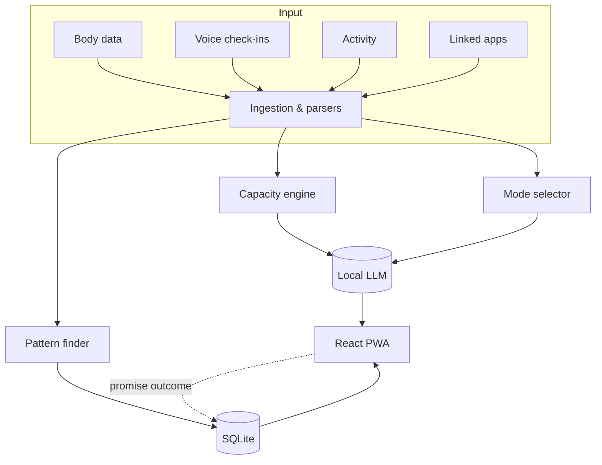

# EchoMe – Proposed Architecture

> Idea-stage design. Everything below runs on the user's own device; no personal data is sent to a cloud service.

## Overview

EchoMe follows a simple **input → processing → output** flow, with a learning loop: every promise's outcome is stored and used to improve future decisions.

## Components

### 1. Input

| Source | What it provides | How it gets in |
|---|---|---|
| Body data | Sleep duration/quality, resting heart rate, steps, stress | Health Connect (Android), Apple Health (iOS), or watch export files (Fitbit via Google Takeout, Samsung Health CSV). Without a watch: phone step count and screen on/off times |
| Voice | Check-ins, promises, why-clips, About Me facts | Microphone → **faster-whisper** (local speech-to-text) |
| Activity | App/window time, calendar events, study sessions | **ActivityWatch** (open-source, local) on laptop; Android usage stats; .ics calendar |
| Linked apps | Project context, proof a promise was kept | **GitHub REST API** via read-only OAuth (chosen repos only); Google Takeout import for YouTube history |

### 2. Processing (FastAPI backend, on device)

- **Ingestion & parsers** – Normalise JSON / CSV exports and transcripts into a common timeline.
- **Capacity engine** – Compares today's sleep, resting HR and recent load with the user's own baseline, and with how much focused work they did on similar past days. Output: an estimate such as "~90 focused minutes today".
- **Mode selector** – Chooses how EchoMe responds when the user drifts or wants to give up:

  | Body state | Mind state | Mode | Response |
  |---|---|---|---|
  | Rested | Drifting / procrastinating | **Push** | Play the user's own why-clip |
  | Depleted (short sleep, high resting HR) | Wants to give up | **Protect** | Move the promise to tomorrow, no self-trust penalty, suggest rest |
  | Any | Signs of real distress in language | **Gentle** | Push disabled; soft check-in; can point to support (e.g. Tele-MANAS 14416) |

- **Pattern finder** – Simple statistics (pandas) over promises, outcomes, body and activity data to propose personal rules, e.g. "You break most promises made after midnight". The user confirms, edits or deletes each rule.
- **Local LLM (Ollama · Gemma 3 4B / Llama 3.2)** – Extracts promises from speech, writes short negotiation and nudge messages, summarises patterns in plain language.
- **SQLite** – Single local database file; easy to export and delete.

### 3. Output (React PWA, laptop + phone)

- **Promise negotiation** – Right-sized, if-then plan for today.
- **Echo nudges** – Voice playback (Push) or a rest suggestion (Protect).
- **Personal manual** – Learned rules; exportable as Markdown.
- **About Me & My Data** – Every stored fact and source; edit, export, "Forget everything".

## Suggested data model

| Table | Key fields |
|---|---|
| `user_profile` | name, goals (JSON), buddy config (JSON) |
| `about_me_facts` | category, text, is_temporary, expires_at, source (voice/text) |
| `health_logs` | date, sleep_hours, sleep_quality, resting_hr, steps, stress |
| `activity_logs` | timestamp, app_or_site, category, duration_mins |
| `voice_logs` | timestamp, transcript, mood, extracted_promise |
| `promises` | created_at, original_text, negotiated_text, capacity_estimate, due_at, status (kept/broken/moved), why_clip_path |
| `manual_rules` | rule_text, evidence_count, status (proposed/confirmed/rejected) |
| `linked_apps` | provider, scope, linked_at, auto_unlink_at, keep_summary |

## Privacy by design

- No cloud APIs for personal data; the LLM and speech-to-text run locally.
- Raw audio is deleted after transcription, except why-clips the user chooses to keep.
- Linked apps are read-only, limited to chosen resources, auto-unlink after the session or 24 hours, and on unlink the user chooses "Forget everything" or "Keep a short summary".
