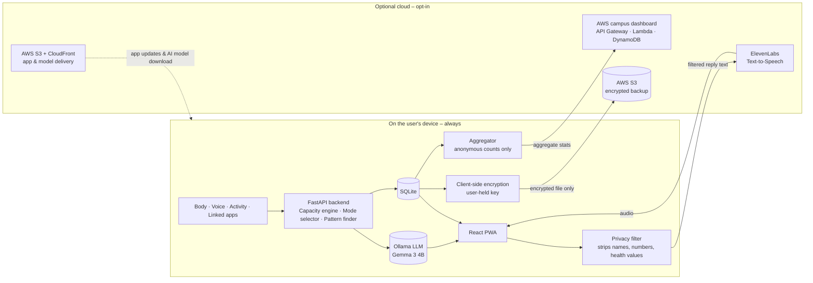

# EchoMe – Optional Cloud Integrations: AWS & ElevenLabs

> How AWS and ElevenLabs fit into EchoMe's architecture without breaking its core promise: **personal data and AI stay on the user's device.**

> **Implemented in the MVP:** ElevenLabs Text-to-Speech for Pip (with the privacy filter) and AWS S3 end-to-end encrypted backup/restore – see [`mvp/backend/cloud.py`](../mvp/backend/cloud.py) and the setup guide in [`mvp/README.md`](../mvp/README.md). The campus dashboard and CloudFront delivery are planned.

## Guiding principle

EchoMe is **local-first**. Everything in the core loop (promise negotiation, echo nudges, Push/Protect, the personal manual) runs on the device. AWS and ElevenLabs power **optional extras** that follow three rules:

1. **Opt-in only.** Each cloud feature is off by default and switched on by the user in settings.
2. **Never raw personal data.** Health data, voice recordings, transcripts and activity logs never leave the device unencrypted.
3. **Works without them.** If a cloud feature is off or offline, EchoMe falls back to a local alternative.

## Architecture with the optional cloud layer

## ElevenLabs integration

### 1. A voice for the buddy (Text-to-Speech)

- **What:** Pip, EchoMe's buddy, can read its replies aloud in a warm, natural voice instead of only showing text.
- **How:** the app sends **only the reply sentence** to the ElevenLabs Text-to-Speech API and plays back the returned audio.
- **Privacy:** a local **privacy filter** removes names, numbers and health values before sending. For example, *"You slept 4.5 hours, so let's do two chapters"* is sent as *"You've had a tiring day, so let's do two chapters."*
- **Fallback:** when off or offline, the phone's built-in text-to-speech or a local model (e.g. Piper) is used.

### 2. Indian-language voices

- **What:** Pip can speak in Indian languages such as Hindi, matching the roadmap goal of reaching students beyond English speakers.
- **How:** the same Text-to-Speech flow, using ElevenLabs' multilingual voices.

### What ElevenLabs is deliberately NOT used for

- **Echo nudges stay the user's real recorded voice.** EchoMe never clones or generates the user's voice. The power of an echo nudge comes from it being genuinely *you*; a synthetic copy would add nothing and would require sending voice recordings to the cloud.
- **No speech-to-text in the cloud.** Listening and transcription stay local (faster-whisper).

## AWS integration

### 1. End-to-end encrypted backup (Amazon S3)

- **What:** users can back up their EchoMe data and restore it on a new phone or laptop.
- **How:** the SQLite database is **encrypted on the device** with a key derived from the user's passphrase, then uploaded to Amazon S3.
- **Privacy:** AWS only ever stores an encrypted file it cannot read. Without the user's passphrase, the backup is unreadable, including to us.

### 2. Campus wellbeing dashboard (for the campus licence)

- **What:** colleges that buy a campus licence get a dashboard showing overall wellbeing trends, e.g. *"average sleep drops 40 minutes in exam weeks"*, to plan support such as counselling drives or deadline spacing.
- **How:** students who opt in share **anonymous, aggregated counts only**, computed on their device. These are sent to a small AWS backend (API Gateway + Lambda + DynamoDB) that powers the dashboard.
- **Privacy:** no individual data, names or raw records ever leave the device. Trends are shown only for groups large enough that no one can be identified (e.g. 20+ students).

### 3. App and AI model delivery (Amazon S3 + CloudFront)

- **What:** fast, reliable delivery of app updates and the on-device AI model download.
- **Privacy:** involves no personal data at all.

## What leaves the device, at a glance

| Feature | Service | What is sent | Personal data? |
|---|---|---|---|
| Buddy voice | ElevenLabs TTS | Filtered reply sentence | No (names, numbers and health values removed) |
| Indian-language voice | ElevenLabs TTS | Filtered reply sentence | No |
| Encrypted backup | AWS S3 | Encrypted database file | Encrypted; unreadable without the user's key |
| Campus dashboard | AWS API Gateway, Lambda, DynamoDB | Anonymous aggregate counts | No |
| App & model delivery | AWS S3 + CloudFront | Nothing (download only) | No |
| Core loop (negotiation, nudges, manual) | — | Nothing | Stays on device |

## How this fits the business model

- **Free tier:** fully local; no cloud costs.
- **Pro (proposed ₹99/month):** includes the ElevenLabs buddy voice and encrypted AWS backup, which covers their pay-per-use cost.
- **Campus licence:** funds the AWS-hosted campus dashboard.

## Hack-day build plan (if shortlisted)

1. Add the privacy filter and ElevenLabs Text-to-Speech for Pip's replies, with a local fallback.
2. Add encrypted backup to S3 with a passphrase-derived key.
3. Stretch goal: a simple campus dashboard on AWS Lambda + DynamoDB using sample aggregate data.
